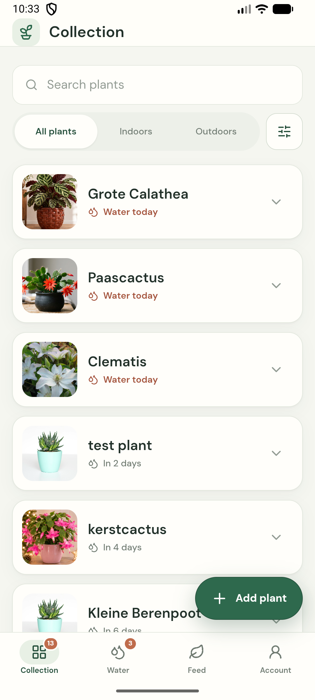
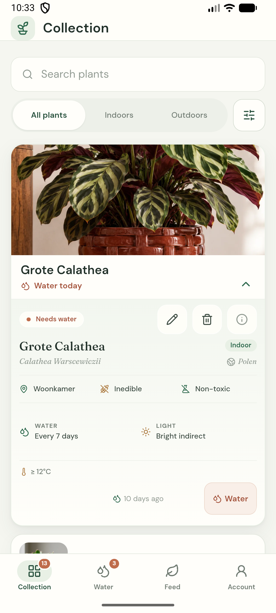
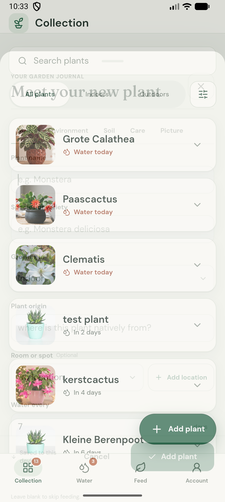

# Plantjes.

**Plantjes.** is a local-first plant care app for keeping track of houseplants and garden plants. Your plants, photos, and care history stay on your device.

<p align="center">
  
  
  
</p>

## Features

- **Plant profiles** — Keep names, photos, locations, light, temperature, humidity, soil, and care notes in one place.
- **Watering and feeding reminders** — See what needs attention today and log care with one tap.
- **Care details that matter** — Track pruning, soil composition, winter hardiness, and edible plant info when you need it.
- **Fast find and filter** — Search by plant, species, or location and filter by indoor/outdoor, location, or care needs.
- **Backup and restore** — Export your full journal as a `.plantjes` file and import it on the same or another device.
- **Works on web and Android** — Use the desktop web app or install the local-run Android APK. The Android app uses the same local-first data model.

## Android app

Plantjes includes a Capacitor-based Android app in [`android/`](./android/). Android builds are produced from `main`, with debug APK pre-releases published on GitHub Releases. The mobile app is designed for local use: no account, no cloud sync, no analytics, and no `INTERNET` permission.

See [MOBILE_RELEASE.md](./MOBILE_RELEASE.md) for release status, build steps, verification evidence, and the mobile task register.

## Run locally

Use Node.js 26, the version CI runs, with npm.

```sh
npm ci
npm run dev
```

Create a production build:

```sh
npm run build
```

Run tests:

```sh
npm test
```

To preview a production build locally, run `npm run preview` after building.

## Data and privacy

Plant records, locations, notes, and uploaded photos are stored locally in IndexedDB (Dexie). There is no account, app server, cloud sync, or telemetry. Clearing browser/site data removes the local journal unless you exported a backup first.

`.plantjes` backups are unencrypted JSON files with embedded photo data. Store them somewhere you trust.

For production web hosting, serve the app over HTTPS and apply the response headers documented in [SECURITY.md](./SECURITY.md).

## Security

Plantjes uses a strict same-origin Content Security Policy, validated/length-bounded inputs, raster-image upload limits, and local-only storage. See [SECURITY.md](./SECURITY.md) for the threat model, OWASP Top 10:2025 mapping, and vulnerability reporting.

## Contributing and support

Code contributions are considered from accounts vetted and approved by the maintainer. Read [CONTRIBUTING.md](./CONTRIBUTING.md) before starting work intended for inclusion. Bug reports and feature requests are welcome; response times are best-effort. Do not include credentials, real plant-journal data, or private photos in public issues or pull requests.

## Developer documentation

- [DEVELOPER.md](./DEVELOPER.md) — application structure, data flow, and extension guidance
- [MAINTAINING.md](./MAINTAINING.md) — repository settings and release steps
- [MOBILE_RELEASE.md](./MOBILE_RELEASE.md) — Android APK status, process, and evidence

## License and third-party assets

**Plantjes.** is released under the [MIT+Beer License](./LICENSE). Bundled fonts, photography, and runtime dependencies keep their own terms; see [THIRD_PARTY_NOTICES.md](./THIRD_PARTY_NOTICES.md).
