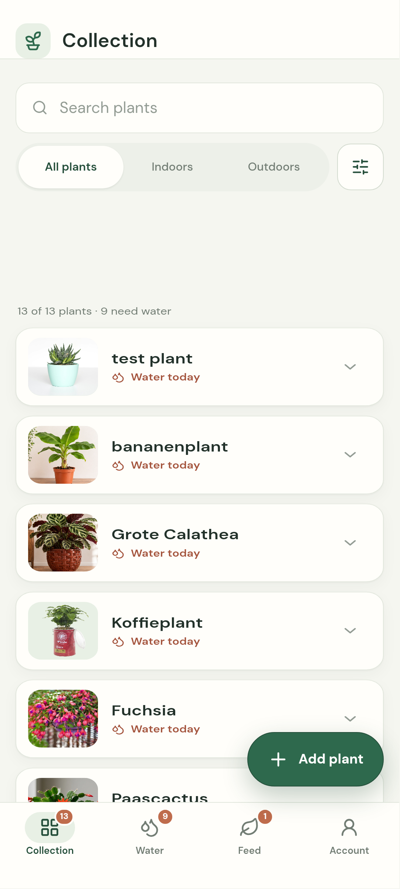
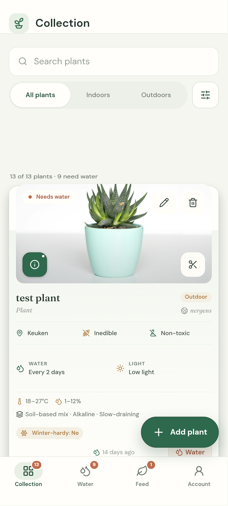
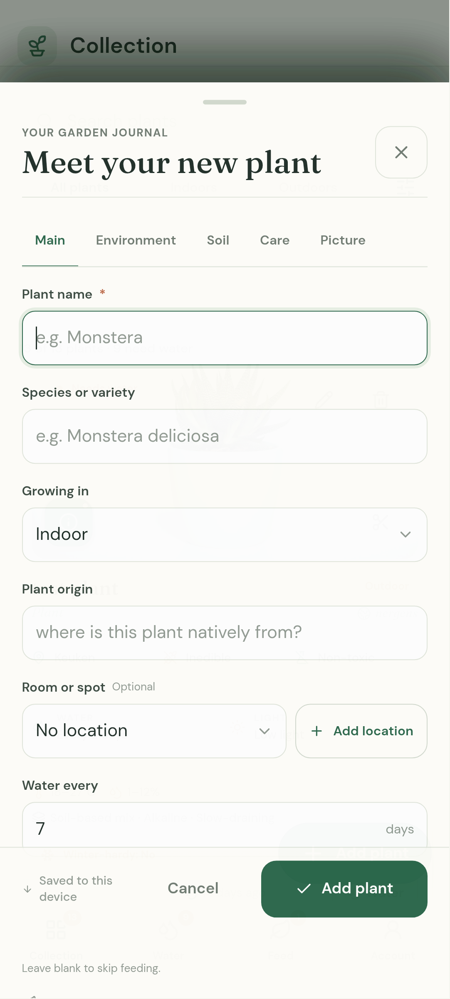
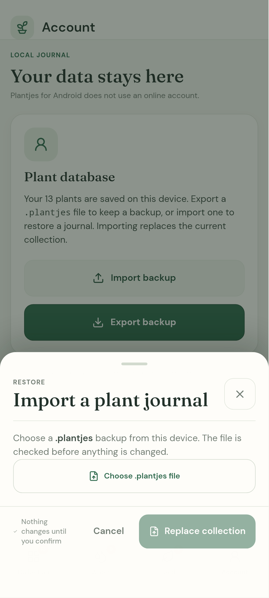
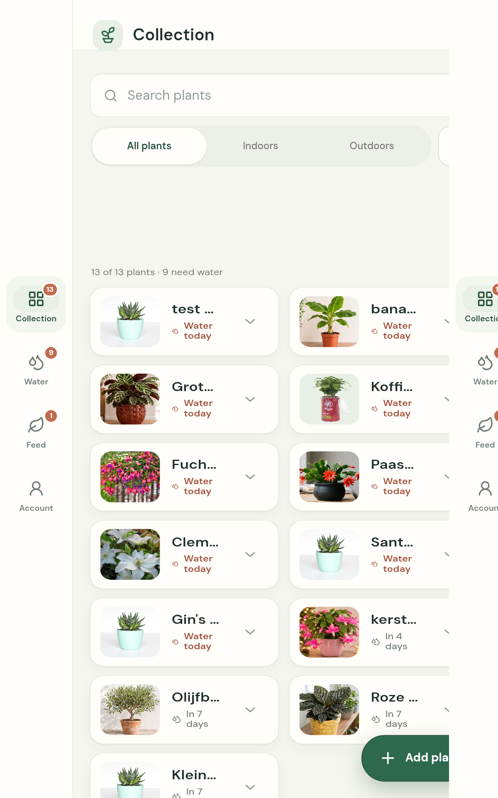
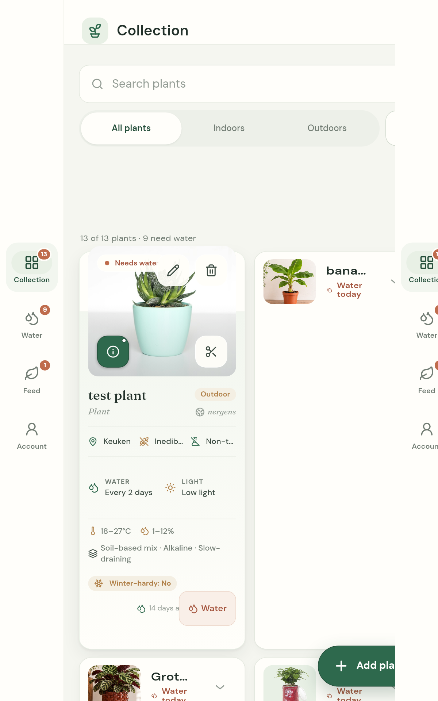

# Issue 93 - Compact mobile collection and dialog polish

Native Android evidence for [#93](https://github.com/Minprez-JP/Plantjes/issues/93), captured on `emulator-5554` (Pixel/Medium phone AVD, Android API 37) after `npm run mobile:build`, `./gradlew assembleDebug`, and `adb install -r`.

## Acceptance evidence

| Area | Evidence | Result |
| --- | --- | --- |
| Compact collection browse | `collection-compact.png` | Mobile collection renders compact side-by-side rows with small image, plant name, and days-until-watering. Measured row height 96px, min-height 88px, 48dp+ touch target. |
| Inline expansion | `collection-expanded.png` | Tapping a compact row expands inline to the full plant card with edit/note/water actions. Measured `aria-expanded="true"` and expanded card rendered below row. |
| Native dialog polish | `plant-dialog.png`, `import-dialog.png` | Dialogs keep bottom-sheet layout with 48x48 close target and 52px primary action height; safe-area padding and full-width actions preserved. |
| 600dp layout | `collection-600dp.png`, `collection-expanded-600dp.png` | Compact rows and expanded card remain usable in the 600dp navigation-rail layout. |

## Screenshots

### Compact collection (360dp-class phone)

### Expanded plant card (360dp-class phone)

### Plant dialog

### Import dialog

### Compact collection (600dp)

### Expanded plant card (600dp)

